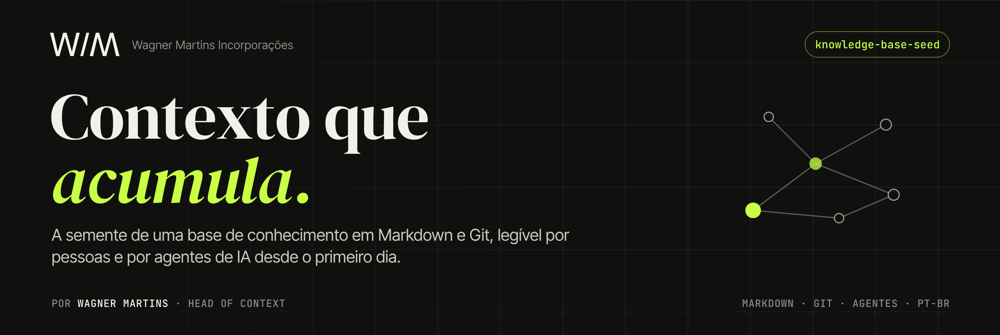

<p align="center">
  
</p>

<p align="center">
  <a href="https://github.com/wagnerlsmartins/knowledge-base-seed/generate"></a>
  <a href="https://github.com/wagnerlsmartins/knowledge-base-seed/stargazers"></a>
  <a href="https://github.com/wagnerlsmartins/knowledge-base-seed/issues/new?template=feedback.md"></a>
</p>

<p align="center">
  <b>Uma solução educacional <a href="https://wagnermartins.in/#portfolio">Playloops</a></b> · por <a href="https://wagnermartins.in">Wagner Martins</a> · W/M Inc.
</p>

---

Todo mundo já tem IA. Quase ninguém tem **contexto**: o conhecimento da empresa, do curso
ou do projeto organizado de um jeito que uma pessoa nova e um agente de IA consigam ler,
entender e continuar o trabalho.

A **Knowledge Base Seed** é a semente desse contexto. Uma base de conhecimento versionada em
Markdown, vivendo no Git, sem CMS e sem lock-in. Você clona, responde oito perguntas e sai
com uma base funcionando, com governança, navegação e prontidão para agentes desde o dia 1.

> [!NOTE]
> Esta semente não nasceu em teoria. Ela condensa as convenções que sobreviveram ao uso em
> bases reais em operação: uma empresa, um curso e um home-lab pessoal. É também o ponto de
> partida dos alunos da formação **Head of Context** (ESPM, 2026).

## O que é (e o que não é)

**É:** uma estrutura de pastas, convenções de frontmatter e rituais de contribuição para
acumular conhecimento de forma durável e portátil.

**Não é:** um wiki com banco de dados, um CMS, ou um lugar para dados brutos sensíveis
(segredos, dados pessoais, exports). Isso fica fora do Git.

## Por onde começar

Leia, nesta ordem, a pasta **[docs/00-comece-aqui](docs/00-comece-aqui/)**:

1. **[As perguntas fundamentais](docs/00-comece-aqui/01_perguntas-fundamentais.md)**: 8 perguntas que definem a sua KB antes de escrever qualquer linha.
2. **[Ferramentas](docs/00-comece-aqui/02_ferramentas.md)**: o que instalar e por quê.
3. **[Como instanciar](docs/00-comece-aqui/03_como-instanciar.md)**: passo a passo para transformar esta semente na *sua* KB.

Se você é um **agente** (Claude, Codex etc.), comece por **[AGENTS.md](AGENTS.md)**.

## Três níveis de adoção

Não é preciso ativar o sistema inteiro no primeiro dia:

| Nível | O que você faz | Resultado |
| --- | --- | --- |
| **1. Constituir** | responde as perguntas, escreve mapa e tese, cria uma área de conteúdo e a primeira nota | a base existe e se explica |
| **2. Operar** | mantém [`STATE.md`](STATE.md), backlog, decisões, logs, calls e handoffs | a base acompanha o trabalho |
| **3. Conectar** | declara fontes canônicas e usa o protocolo de interoperabilidade | a base conversa com outras bases e sistemas |

## Estrutura

```text
docs/
  00-comece-aqui/   perguntas, ferramentas e guia de instanciação (apague depois de ler)
  01-base/          fundação: mapa, tese, léxico, entidades
  02-conteudo/      o conhecimento do seu objeto (você cria as seções)
  09-operacao/      governança da própria base: schema, camadas, ingestão
views/              trilhas de leitura por público (≠ estrutura de pastas)
type/               tipos de nota como lente de navegação
projeto/            "SO de projeto": inbox → nota → decisão → backlog → log → handoff (opcional)
scripts/            utilitários para ingestão e auditoria leve da KB
STATE.md            estado atual, próximo gate, riscos e frentes sem movimento
AGENTS.md           instruções para agentes de IA
CONTRIBUTING.md     fluxo de contribuição (PR-only)
```

O [`STATE.md`](STATE.md) é a leitura operacional curta. O mapa explica **o que a base é**; o
estado registra **onde ela está agora**.

Antes de abrir uma PR, rode `python3 scripts/audit-kb.py`. A auditoria verifica frontmatter
estrutural, UTF-8 na leitura e links locais. Para limites de dados e resposta a incidentes,
veja a [política de segurança](.github/SECURITY.md).

## Uso esperado

- documentação institucional, de produto ou de curso
- base pública, semi-pública ou privada
- fonte de contexto para agentes e MCP
- memória operacional versionada (calls, decisões, handoffs)

## Gostou? Deixe sua estrela e seu comentário

Esta semente melhora com quem usa. Se ela te ajudou a montar a sua base:

- ⭐ **Dê uma estrela** no topo da página. É o que faz a semente chegar a mais gente.
- 💬 **[Deixe seu comentário](https://github.com/wagnerlsmartins/knowledge-base-seed/issues/new?template=feedback.md)**: o que funcionou, onde você travou, o que faltou.
- 🌱 **Conte o que você plantou**: se a sua KB for pública, mande o link no comentário.

## Sobre

Criada e mantida por **[Wagner Martins](https://wagnermartins.in)**, que faz empresas para a
era dos agentes na W/M Inc. (Wagner Martins Incorporações): negócios com contexto que
acumula, protocolos que executam e infraestrutura pública que permanece.

A semente é a primeira solução educacional da **Playloops**, a editora de protocolos
operacionais para humanos e agentes da W/M Inc. *Loops são o novo prompt.*

> [!TIP]
> Criou a sua KB a partir deste template? Reescreva este README para falar da *sua* base e
> apague `.github/assets/` e `.github/ISSUE_TEMPLATE/feedback.md`. Eles são a vitrine da
> semente, não da sua KB. Veja o passo 9 de [Como instanciar](docs/00-comece-aqui/03_como-instanciar.md).
